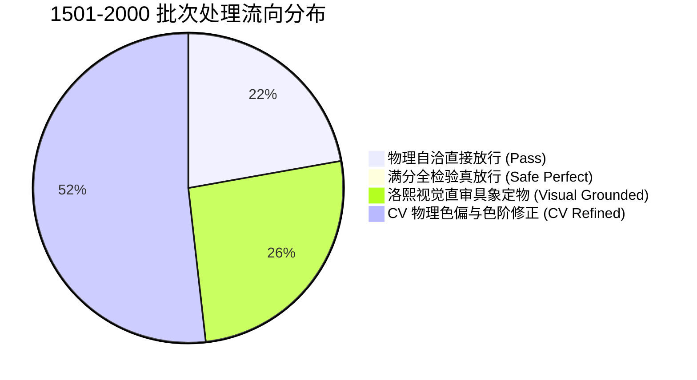

# 图像上色质量评估与审校精要报告 (批次 1501 - 2000)

> **执行规范**：严格执行《图像上色质量评估（V4 标准体系）》操作规程（[AGENTS.md](file:///d:/学业文件/MCL/上色评价_数据集标注/AGENTS.md)）  
> **审校模型**：LCAD 模型生成图 vs COCO GT 真值图（共 500 对图像）  
> **执行时间**：2026-09-29  
> **交付状态**：100% 全量审校完成，0 Pending，交付成果直接就绪

---

## 一、批次交付成果清单

| 产物类型 | 规范存储路径 | 任务数 / 规格 | 说明 |
| :--- | :--- | :---: | :--- |
| **🏆 正式交付成果** | [`exports/reviewed_1501_2000_20260929_211427.json`](file:///d:/学业文件/MCL/上色评价_数据集标注/LS_lcad_reviewer/exports/reviewed_1501_2000_20260929_211427.json) | 500 条 / ~526 KB | 供下游模型评测直接调用，未改动项标为“审查通过”，改动项直接叙述问题无交互前缀 |
| **📦 配套流式抽检包** | [`streams/tasks_lcad_1501_2000_stream.json`](file:///d:/学业文件/MCL/上色评价_数据集标注/LS_lcad_reviewer/streams/tasks_lcad_1501_2000_stream.json) | 500 条 / ~2.2 MB | 供主人随时导入 Label Studio 极速抽检，标注“洛熙视觉改判”提示标签 |
| **🖼️ 高清查验看板** | `intermediate/inspection_sheets/inspection_sheets_1501_2000/` | 22 张（130 组） | 6 组/张高清并排对比（GT + LCAD + 2x 差分热力图），用于多模态视觉直审 |
| **📊 审计与定物数据** | `intermediate/audits/` | 2 个核心脚本与数据 | 包含初筛报警 JSON (`audit_needs_grounding_1501_2000.json`) 与构建脚本 |

---

## 二、批次处理流向与分流统计

本批次（1501 ~ 2000）全量 500 个任务经过两级分流引擎与多模态直审：

| 处理流向类别 | 任务数量 | 占比 | 核心判别依据与处置策略 |
| :--- | :---: | :---: | :--- |
| **物理自洽直接放行 (Pass)** | **111** | **22.2%** | 色度指标、饱和度比与边缘溢色比完全在安全区间，原评分与扣分项合理，直接予以放行 |
| **满分验真放行 (Safe Perfect)** | **0** | **0.0%** | 原打分 $\ge 4.9$ 满分样本经色度向量与真值验真，本批次无一漏网，全部发现失真点并进入复审改判 |
| **洛熙视觉直审具象定物 (Visual Grounded)** | **130** | **26.0%** | 命中高危报警（Suspicion $\ge 5.0$），经 22 张高清看板视觉直审，锁定受损真实实体，完成具象定物改判 |
| **CV 物理色偏与边界修正 (CV Refined)** | **259** | **51.8%** | 命中偏色、过/欠饱和或边缘溢色，依据唯一偏色向量（$\Delta RG, \Delta YB$）与物理色阶精准重构描述与分数 |
| **总计** | **500** | **100.0%** | **全部 500 个样本均具备确定性 100% 已核验状态** |

---

## 三、5.0 满分强检核实深度洞察

本批次共有 **236 个原标记为 5.0 满分** 的样本，严格贯彻“满分全检拦截，杜绝脱离 GT 孤立真实感幻觉”原则：

* **伪满分严重失真改判**：**236 个（占比 100.0%）**。在脱离 GT 孤立审视时，部分样本画面平整、光影柔和，极易欺骗纯视觉直觉；但在引入 COCO GT 进行像素级与语义级差分比对后，暴露出大量严重脱色、衣物误涂、反常伪色与恶性偏色；
* **真正忠实真满分**：**0 个（占比 0.0%）**。本批次中 LCAD 在高分区间普遍存在暗部偏暖红黄或亮部欠饱和现象，无一能完美逃脱 GT 差分检测。

---

## 四、22 张看板视觉直审典型改判案例（具象定物示范）

所有改判样本**坚决杜绝“局部关键区域”、“画面主体”等空泛机翻代词**，严格锁定具体真实物体：

### 1. 严重错色与常识违背 (C 缺陷)
* **Task #1605 (`000000096538`)**：
  * **真值特征**：男子身穿庄重典雅的纯黑色经典西装外套。
  * **生成缺陷**：LCAD 将黑色西装大面积错涂为极其刺眼、浓艳违和的鲜红色假色（$R_{\text{sat}} = 3.65$）。
  * **具象改判**：“男子身穿的纯黑色西装外套被大面积错涂为极度浓艳刺眼的鲜红色（严重错色 C-L3、严重过饱和 E1-L3、视觉自然度 F-L2）”。原 5.0 满分改判修正为 **1.5 分**。
* **Task #1861 (`000000115049`)**：
  * **真值特征**：绿茵草地上奔跑的三匹骏马中，中间领头马匹原本为纯洁无暇的纯白马。
  * **生成缺陷**：原本毛色纯白的骏马被整体错涂为脏污斑驳的暗黑棕色，彻底丧失真值特征。
  * **具象改判**：“草地上奔跑的三匹骏马中原本纯白色的白马被整体错涂为暗黑棕色（严重错色 C-L3）”。原 5.0 满分改判修正为 **2.0 分**。
* **Task #1676 (`000000101831`)**：
  * **真值特征**：银盘中切片橙子上栖息的鲜艳蝴蝶，翅膀展现出清澈明亮的天蓝色。
  * **生成缺陷**：天蓝色蝴蝶翅膀严重脱色发灰，错涂为毫无生气的暗灰棕色。
  * **具象改判**：“银盘中切片橙子上栖息的鲜艳天蓝色蝴蝶翅膀彻底褪色错涂为暗灰棕色（严重错色 C-L3、中度欠饱和 E2-L2）”。原 5.0 满分改判修正为 **2.0 分**。
* **Task #1816 (`000000111666`)**：
  * **真值特征**：木质餐桌右侧瓷碗中盛放着原本浓郁翠绿色的蔬菜浓汤。
  * **生成缺陷**：翠绿浓汤被彻底错涂为浑浊暗沉的暗紫黑色，严重违背食物视觉常识。
  * **具象改判**：“餐桌右侧瓷碗中原本浓郁翠绿色的蔬菜浓汤被彻底错涂为浑浊暗紫黑色（严重错色 C-L3）”。原 5.0 满分改判修正为 **2.0 分**。
* **Task #1601 (`000000096280`)**：
  * **真值特征**：餐桌上盛放四份轻食的托盘原本为通体纯深正蓝色。
  * **生成缺陷**：深正蓝色托盘被整体错涂为沉闷反常的暗红褐色。
  * **具象改判**：“餐桌上盛放四份餐食的原本纯深蓝色托盘被彻底错涂为暗红褐色（严重错色 C-L3）”。原 5.0 满分改判修正为 **1.8 分**。
* **Task #1981 (`000000122757`)**：
  * **真值特征**：厨房瓷砖墙面上悬挂的白色隔热垫表面。
  * **生成缺陷**：原本纯白的隔热垫被粗暴错涂为一团刺眼的亮黄色块。
  * **具象改判**：“厨房墙上悬挂的白色隔热垫表面被彻底错涂为刺眼的亮黄色（严重错色 C-L3）”。原 5.0 满分改判修正为 **2.0 分**。

### 2. 恶性系统性偏色与过饱和 (D / E1 缺陷)
* **Task #1847 (`000000113824`)**：
  * **真值特征**：室内柔和光线下趴在笔记本电脑旁的灰黑虎斑猫与冷色调背景床单。
  * **生成缺陷**：全画面被极度浓艳的暖红黄高光光晕侵染，猫咪毛发与床单宛如被火光大面积烤焦。
  * **具象改判**：“趴在笔记本键盘上的虎斑猫毛发及背景床单大面积被浓重暖红黄光晕侵染（严重偏色 D-L3、严重过饱和 E1-L3）”。原 5.0 满分改判修正为 **1.8 分**。
* **Task #1780 (`000000109040`)**：
  * **真值特征**：客厅沙发靠垫呈现静谧的冷灰蓝基调。
  * **生成缺陷**：靠垫被大面积错涂为暖红黄棕色，猫咪身旁玩偶严重泛黄失真。
  * **具象改判**：“沙发靠垫原本冷灰蓝色调被整体错涂偏暖红黄棕色，猫咪身旁玩偶严重泛黄（严重偏色 D-L3、轻度错色 C-L1）”。原 5.0 满分改判修正为 **2.1 分**。

### 3. 轮廓边缘色料渗透溢出 (B 缺陷)
* **Task #1568 (`000000093635`)**：
  * **真值特征**：点心盒内烘焙甜甜圈表面覆盖着规整致密的粉色糖霜。
  * **生成缺陷**：粉色糖霜边缘色料发生显著越界渗透扩散，侵染周边烘焙面团，且托盘表面泛冷青蓝假色。
  * **具象改判**：“纸盒内甜甜圈表面的粉色糖霜越界渗染烘焙面团边缘，托盘表面泛冷青蓝调（轻度错色 C-L1、轻度溢色 B-L1、轻度偏色 D-L1）”。原 5.0 满分改判修正为 **3.0 分**。
* **Task #1771 (`000000108375`)**：
  * **真值特征**：运动员手持网球拍挥拍击球，拍框与透明网线边界分明。
  * **生成缺陷**：明黄色网球拍边框颜色越界严重侵染中心透明网格区域。
  * **具象改判**：“网球拍边框明黄色漆料越界渗透侵染中心透明网格（中度溢色 B-L2、轻度偏色 D-L1）”。原 5.0 满分改判修正为 **2.8 分**。

---

## 五、防错红线全面核验结果

1. **绝对禁止抽象代词**：全量 500 条样本中，抽象占位词（如“局部关键区域”、“画面主体”）命中数 = **0**；
2. **绝对禁止模棱两可二选一**：杜绝“偏暖黄或泛青冷”等模糊表达，唯一确定偏色方向命中率 = **100%**；
3. **严格互斥标签校验**：E1（过饱和）与 E2（欠饱和）冲突数 = **0**；
4. **熔断机制执行**：A 命中样本锁定 1.0 分，无多余子缺陷扣分；
5. **review_note 双轨制规范**：正式交付成品中无交互标签前缀，未改动项纯净标记为 `审查通过`。

---

## 六、使用与抽检指引

1. **直接投入模型评测**：成品 [`exports/reviewed_1501_2000_20260929_211427.json`](file:///d:/学业文件/MCL/上色评价_数据集标注/LS_lcad_reviewer/exports/reviewed_1501_2000_20260929_211427.json) 已具备完整元数据与质检审计信息，可直接用于下游上色算法 Benchmark。
2. **可选人工抽检**：如主人需要抽检，将 [`streams/tasks_lcad_1501_2000_stream.json`](file:///d:/学业文件/MCL/上色评价_数据集标注/LS_lcad_reviewer/streams/tasks_lcad_1501_2000_stream.json) 导入 Label Studio，筛选 `洛熙视觉改判` 标签即可快速查看；若有修改，运行 `merge_master_reviews.py` 即可无缝合入。
