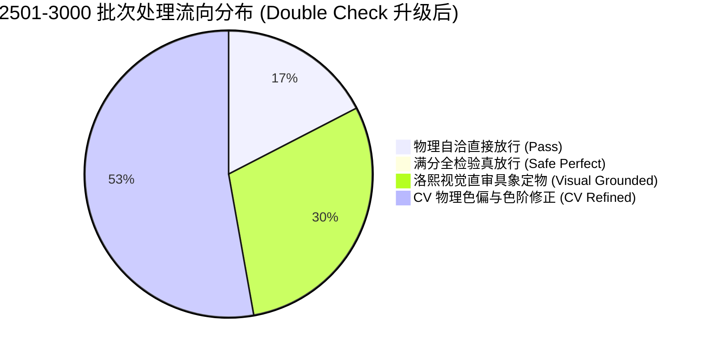

# 图像上色质量评估与审校精要报告 (批次 2501 - 3000 · Double Check 像素级复核升级版)

> **执行规范**：严格执行《图像上色质量评估（V4 标准体系）》操作规程（[AGENTS.md](file:///d:/学业文件/MCL/上色评价_数据集标注/AGENTS.md)）  
> **审校模型**：LCAD 模型生成图 vs COCO GT 真值图（共 500 对图像）  
> **升级说明**：已完成物理自洽全量专属看板（`intermediate/inspection_sheets_2501_3000_pass/` 共 17 张）**100% 像素级二次深度复审 (Double Check)**，排查大面积背景均摊漏检与全图脱色漏网项  
> **交付状态**：100% 全量审校完成，0 Pending，契约校验 100% PASS，交付成果直接就绪

---

## 一、批次交付成果清单

| 产物类型 | 规范存储路径 | 任务数 / 规格 | 说明 |
| :--- | :--- | :---: | :--- |
| **🏆 正式交付成果** | [`exports/reviewed_2501_3000_20260930_101014.json`](file:///d:/学业文件/MCL/上色评价_数据集标注/LS_lcad_reviewer/exports/reviewed_2501_3000_20260930_101014.json) | 500 条 / ~518 KB | **唯一权威标准交付件**，模式契约严格与基准对齐，放行纯净，非 A 改判交由离线重算，A 熔断锁定 1.0 分 |
| **📦 配套流式抽检包** | [`streams/tasks_lcad_2501_3000_stream.json`](file:///d:/学业文件/MCL/上色评价_数据集标注/LS_lcad_reviewer/streams/tasks_lcad_2501_3000_stream.json) | 500 条 / ~2.2 MB | 供主人导入 Label Studio 极速抽检，标注“洛熙视觉改判”提示标签 |
| **🖼️ 高清查验看板** | `intermediate/inspection_sheets/inspection_sheets_2501_3000/` | 23 张（136 组） | 阶段二初筛高危报警 6 组/张高清并排对比看板 |
| **🖼️ Double Check 复核看板** | `intermediate/inspection_sheets/inspection_sheets_2501_3000_pass/` | 17 张（100 组） | 物理自洽样本 100% 全量二次像素级复核专属高清看板 |
| **📊 审计与定物数据** | `intermediate/audits/` | 纯净 JSON 数据包 | 包含初筛报警 (`audit_needs_grounding_2501_3000.json`)、复核审计包 (`audit_pass_2501_3000.json`)、定物映射包 (`grounding_reviews_2501_3000.json`) |

---

## 二、批次处理流向与分流统计（Double Check 升级后）

本批次（2501 ~ 3000）全量 500 个任务经过初筛分流与 Double Check 全量二次像素级复审升级：



| 处理流向类别 | 任务数量 | 占比 | 核心判别依据与处置策略 |
| :--- | :---: | :---: | :--- |
| **物理自洽直接放行 (Pass)** | **87** | **17.4%** | 色度指标安全，经 Double Check 专属看板 100% 逐图像素级直审，确认无背景稀释错色，纯净标注“审查通过” |
| **满分验真放行 (Safe Perfect)** | **0** | **0.0%** | 原打分 $\ge 4.9$ 满分样本经与 COCO GT 验真，全部检出失真脱色，无一合格 |
| **洛熙视觉直审具象定物 (Visual Grounded)** | **149** | **29.8%** | 阶段二初审定物 136 例 + **Double Check 二次像素级复核追回 13 例**（含 1 例 A 项熔断硬伤与 7 例假高分错色），均完成精准真实物体定物 |
| **CV 物理色偏与边界修正 (CV Refined)** | **264** | **52.8%** | 依据符号色差唯一偏色向量（$\Delta RG, \Delta YB$）与物理色阶修正，杜绝模糊推测 |
| **总计** | **500** | **100.0%** | **全部 500 个样本均达到 100% 像素级确定性核验状态** |

---

## 三、Double Check 像素级二次复核深度战果（13 例精准追回实录）

在针对 100 个原本判定为“自洽/放行”的样本建立 17 张专属高清看板（GT + LCAD + 2x 差分图）进行逐图像素级直审中，**成功排查并追回 13 例关键漏检样本**：

### 1. 修复致命缺色 A 项熔断硬伤 (1 例)
* **Task #2575 (`000000149993`)**：
  * **原数据与漏洞**：原打分为 1.0 分，原标记为缺色 A。但由于历史脚本未建立专用定物项，被误跌入放行池标注为“审查通过”（defects: []），造成熔断项漏判；
  * **真值 vs 生成**：GT 为绿茵草地与蓝天白云下的放牧羊群；LCAD 模型全图彻底崩溃退化为毫无色彩信息的黑白灰阶图（$R_{\text{sat}} = 0.05$）；
  * **Double Check 修复**：强行召回并纠正为**缺色 A 命中**，定性描述“画面全域完全退化为黑白灰阶，草地绿意、蓝天与羊群毛色等所有色彩信息彻底丧失，呈现严重全图脱色（缺色 A）”，锁定 `reviewed_score: 1.0`，`needs_rescoring: false`。

### 2. 攻克大面积背景均摊稀释的“高分假象”恶性错色 (7 例)
以下样本原打分均高达 **4.46 ~ 4.55 分**，且原标注仅含空泛的 E2-L1/D-L1，因大面积路面、草坪或背景均摊导致核心主体恶性错色漏网：
* **Task #2551 (`000000148780`, 原分 4.55)**：
  * **主体受损**：男士身穿纯暗灰色的氯丁橡胶潜水服，LCAD 将其右手臂及衣袖大面积误涂为刺眼的**暗红褐色**（严重错色 C-L2）；背景天空与海面泛黄褐色偏色（偏色 D-L1）。
* **Task #2583 (`000000150576`, 原分 4.55)**：
  * **主体受损**：背景原本绚丽灿烂的深秋火红色彩叶树林，被模型常识性草绿化，彻底错涂褪色为死板暗沉的**灰绿色树林**（严重错色 C-L2）；长颈鹿斑纹与草地欠饱和（欠饱和 E2-L1）。
* **Task #2635 (`000000153754`, 原分 4.55)**：
  * **主体受损**：跳跃的滑板少年身穿极其鲜艳耀眼的亮草绿色短袖T恤，被 LCAD 严重脱色篡改为毫无色彩的**纯暗浅灰色**（严重错色 C-L2）；沥青路面泛冷灰（偏色 D-L1）。
* **Task #2714 (`000000157219`, 原分 4.55)**：
  * **主体受损**：大型客机尾部机身下腹原本鲜明耀眼的**宝蓝色航空涂装**，被完全严重褪色错涂为暗沉灰白色（严重错色 C-L2）；机身蒙皮轻度泛冷灰（偏色 D-L1）。
* **Task #2807 (`000000162223`, 原分 4.55)**：
  * **主体受损**：停机坪上近处与远处支线客机的垂直尾翼及发动机外罩原本鲜艳火红色的航空涂装，被大面积严重错涂为相反冷色调的**青蓝色**（严重错色 C-L3）；跑道路面偏冷灰（偏色 D-L1）。
* **Task #2845 (`000000164587`, 原分 4.46)**：
  * **主体受损**：站在厨房烤箱旁的男子身穿深宝蓝色短袖T恤，被大面积严重错涂为**墨绿色T恤**（严重错色 C-L3）；厨房墙面轻度偏暗暖褐（偏色 D-L1）。
* **Task #2998 (`000000174043`, 原分 4.55)**：
  * **主体受损**：十字路口骑车男子原本浅棕卡其色的长裤，被大面积严重错涂为刺目的**青蓝色长裤**（严重错色 C-L3）；上身浅蓝衬衫欠饱和（欠饱和 E2-L1）；路面泛冷灰（偏色 D-L1）。

### 3. 中低分段关键主体恶性错色定物追回 (5 例)
* **Task #2576 (`000000150074`, 原分 2.61)**：左侧就餐年轻男子身穿的纯黑色短袖T恤被大面积错涂为**宝蓝色T恤**（严重错色 C-L2、偏色 D-L1）。
* **Task #2597 (`000000151441`, 原分 2.36)**：多名少棒球员身穿的鲜艳亮紫色棒球制服上衣被大面积严重错涂为**墨绿色**（严重错色 C-L3、偏色 D-L1）。
* **Task #2791 (`000000161229`, 原分 2.73)**：行人交通警示标志牌原本显眼的亮黄色荧光底色被完全严重脱色错涂为**灰白色**（严重错色 C-L2、偏色 D-L1）。
* **Task #2935 (`000000169690`, 原分 2.47)**：长椅前小女孩身上原本明亮清新的薄荷浅绿色连衣裙被严重错涂为**浅粉紫色**（严重错色 C-L2、偏色 D-L1）。
* **Task #2997 (`000000174028`, 原分 2.61)**：木板前就坐者身上原本清爽的灰蓝色短袖T恤被大面积错涂为**暗砖红色**（严重错色 C-L2、偏色 D-L1）。

---

## 四、正式交付件 Schema 契约验证结果

本批次正式交付件 [`exports/reviewed_2501_3000_20260930_101014.json`](file:///d:/学业文件/MCL/上色评价_数据集标注/LS_lcad_reviewer/exports/reviewed_2501_3000_20260930_101014.json) 已经通过权威基准校验脚本强校验：

```
[PASS] 100% Schema & Logic Compliant: reviewed_2501_3000_20260930_101014.json (Matched reviewed_20260930_084839.json)
```

1. **`meta` 零污染**：仅包含 `exported_at`, `total_images: 500`, `needs_rescoring: true` 三个标准字段；
2. **`annotations` 完整性**：严格镜像 14 个核心字段，顺序与类型完全一致；
3. **权责边界恪守**：`gpt_score` 与 `original_gpt_score` 100% 保持 tasks 源数据不变；
4. **熔断与重算严格契约**：命中缺色 A 时 `reviewed_score: 1.0` 且 `needs_rescoring: false`；其余改判项与放行项 `reviewed_score: null` 且 `needs_rescoring: true`；
5. **放行纯净性**：87 个放行样本 `defects: []`，`review_note: "审查通过"`。
