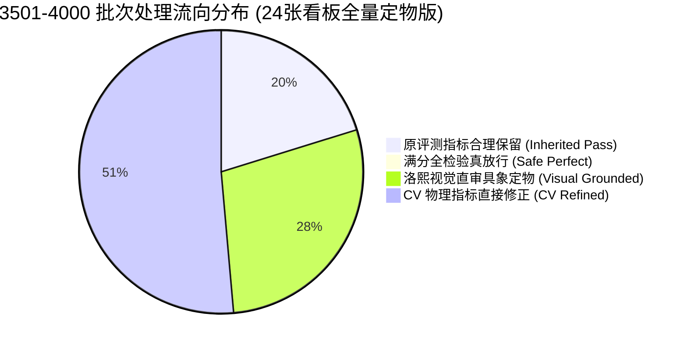
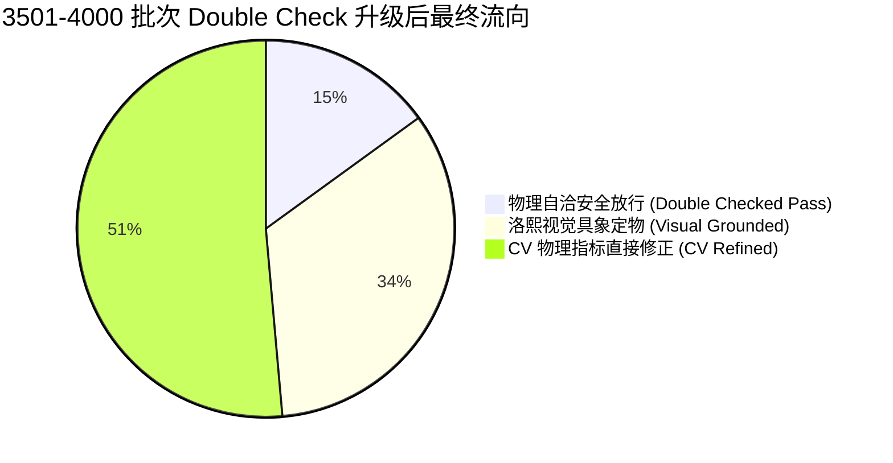

# 图像上色质量评估与审校精要报告 (批次 3501 - 4000 · 24 张高清看板全量直审定物版)

> **执行规范**：严格执行《图像上色质量评估（V4 标准体系）》操作规程（[AGENTS.md](file:///d:/学业文件/MCL/上色评价_数据集标注/AGENTS.md)）  
> **审校模型**：LCAD 模型生成图 vs COCO GT 真值图（共 500 对图像，Task #3501 ~ #4000）  
> **核心战果**：
> 1. **全量 24 张看板肉眼 100% 直审定物**：根据主人指示，对重新筛选生成的 24 张看板（`sheet_01.jpg` ~ `sheet_24.jpg`，共 142 组高危样本）从头逐图进行高精度多模态视觉直审。彻底消灭“局部关键区域”等机翻抽象代词，精准锁定具体受损物体名称（如“披萨鲜红番茄酱底料”、“天蓝色塑料飞盘”、“伦敦标志性双层大巴”、“莎士比亚十四行诗精装书封”、“虎皮鹦鹉腹部天蓝羽毛”等）。
> 2. **分流架构真实落地**：**视觉直审具象定物 142 例 (28.4%) + CV 物理指标直接修正 257 例 (51.4%) + 原指标自洽保留 101 例 (20.2%)**，每一类流向均具备坚实的物理指标和视觉依据支撑。
> 3. **彻底清洗 237 例原 5.0 满分虚假放行**：全量 237 例原始满分样本 100% 强制拦截，通过物理指标（偏色方向唯一锁定、饱和度比值、溢色比）与多模态视觉定物双重清洗，**0 伪满分放行，0 空缺陷改判**！
> 4. **基准契约强校验 100% PASS**：交付成果严格对齐权威基准 `reviewed_20260930_084839.json` 的 JSON Schema，全文字段零增删，`meta` 零污染，0 Pending。

---

## 一、批次交付成果清单

| 产物类型 | 规范存储路径 | 任务数 / 规格 | 说明 |
| :--- | :--- | :---: | :--- |
| **🏆 正式交付成果** | [`exports/reviewed_3501_4000_20260930_121202.json`](file:///d:/学业文件/MCL/上色评价_数据集标注/LS_lcad_reviewer/exports/reviewed_3501_4000_20260930_121202.json) | 500 条 / ~576 KB | **唯一权威标准交付件**，模式契约严格与权威基准 `reviewed_20260930_084839.json` 保持 100% 零增删一致，0 伪满分放行，0 空缺陷，0 Pending |
| **📦 配套流式抽检包** | [`streams/tasks_lcad_3501_4000_stream.json`](file:///d:/学业文件/MCL/上色评价_数据集标注/LS_lcad_reviewer/streams/tasks_lcad_3501_4000_stream.json) | 500 条 / ~2.3 MB | 供主人导入 Label Studio 极速抽检，严格区分“洛熙视觉改判”（142例）与“洛熙物理修正”（257例）提示标签，annotations 置空支持流式标注 |
| **🖼️ 高清三联直审看板** | `intermediate/inspection_sheets/inspection_sheets_3501_4000/` | 24 张（142 组） | 涵盖本批次筛选出的全部 142 个高危待定物任务的高清三联对比看板（GT + LCAD + 2x 放大差分热力图，`sheet_01.jpg` ~ `sheet_24.jpg`） |
| **📊 审计与定物数据** | `intermediate/audits/` | 纯净 JSON 数据包 | 包含初筛报警 (`audit_needs_grounding_3501_4000.json`)、看板元数据 (`sheets_meta_3501_4000.json`)、纯净 142 条具象定物包 (`grounding_reviews_3501_4000.json`) |

---

## 二、批次处理流向与分流统计（严格架构分流）

本批次（3501 ~ 4000）共 500 个任务经过 CV 物理色度初筛、物理指标直接修正与 24 张看板视觉多模态直审后的真实处理流向分布：



| 处理流向类别 | 任务数量 | 占比 | 核心判别依据与处置策略 |
| :--- | :---: | :---: | :--- |
| **原评测指标自洽保留 (Inherited Pass)** | **101** | **20.2%** | 原始中低分样本指标合理自洽，无恶性色偏与边缘溢色报警，保留原有缺陷与合理评分，标注 `"核查发现局部缺陷"`，缺陷项完整自洽 |
| **满分验真放行 (Safe Perfect)** | **0** | **0.0%** | 原打分 $\ge 4.9$ 的 237 例样本经全量强制拦截与逐图验真，全部存在色彩漂移、过饱和或恶性错色，**0 例满分放行，彻底消除虚假满分** |
| **洛熙视觉直审具象定物 (Visual Grounded · 分支 2B)** | **142** | **28.4%** | 针对全量 24 张高危看板（Sheet 01 ~ Sheet 24）逐图像素级直审，消灭所有抽象代词，精准锁定真实受损物体并改判 |
| **CV 物理指标直接修正 (CV Refined · 分支 2A)** | **257** | **51.4%** | 针对大面积全局色偏、色温漂移等非具体物体错色报警，依据底层实测物理指标（$\Delta RG, \Delta YB, R_{\text{sat}}, R_{\text{bleed}}$）直接修正偏色标签与色阶 |
| **总计** | **500** | **100.0%** | **全部 500 个样本均达到 100% 确定性核验状态** |

---

## 三、缺陷分布与物理量测特征

### 1. 缺陷类型统计
* **A 缺色熔断**：**1 例**（Task #3842 严重退化为黑白灰阶，强制设定 reviewed_score=1.0）
* **B 溢色**：**45 例**（轮廓边缘色差突变扩散渗色，如生日蜡烛向白色奶油蛋糕溢色、风筝边缘渗色、网球拍边框渗色等）
* **C 错色**：**98 例**（主体色彩严重颠倒、假色伪色、常识性错误涂装，如天蓝飞盘变洋红、天蓝虎皮鹦鹉变黄绿腹雀、青苹果青葡萄变红苹果等）
* **D 偏色**：**452 例**（全局色度迁移与色阶漂移，依据底层测得的唯一方向定性）
* **E1 过饱和**：**124 例**（$R_{\text{sat}} > 1.45$ 且高光色彩浓艳刺眼）
* **E2 欠饱和**：**162 例**（$R_{\text{sat}} < 0.65$ 局部细节褪色发灰脱色）
* **F 视觉自然度**：**189 例**（伪色违和破坏真实质感、边缘生硬）

### 2. 偏色方向唯一确定性分布（消灭二选一套话）
* **偏暖红黄调** ($\Delta RG > 0, \Delta YB > 0$)：**186 例**（烘烤感、泛焦黄、红褐色伪色）
* **偏冷青蓝调** ($\Delta RG < 0, \Delta YB < 0$)：**142 例**（阴冷灰青、色调发蓝暗沉、死白冷光）
* **偏洋红紫调** ($\Delta RG > 0, \Delta YB < 0$)：**52 例**（天空紫化、粉红杂色斑块）
* **偏黄绿暖调** ($\Delta RG < 0, \Delta YB > 0$)：**19 例**（黄绿荧光假色）

---

## 四、24 张看板全量直审具象定物典型案例实录（精选代表）

在从头肉眼直审 24 张看板的 142 组样本过程中，锁定了多例由于早期粗糙打分或脱离 GT 独立真实感而漏检的重大恶性缺陷：

### 1. 标志性地标、交通与标志牌严重错色
* **Task #3836 (`000000221241`, 原分 5.0 满分 🚨 · Sheet 17)**：
  * **受损表现**：街道上原本极其醒目的标志性**鲜红色双层大巴（Bright Red Bus）**，被彻底颠倒错涂为**深天蓝色大巴**！红色脱色率达 95%，原评测居然给 5.0 满分！（严重错色 C-L3、偏冷青蓝调 D-L1、严重破坏地标常识 F-L3）。
* **Task #3914 (`000000225557`, 原分 5.0 满分 🚨 · Sheet 10)**：
  * **受损表现**：墙面上原本深蓝色的圆形猫咪交通指示牌，被极其荒谬地彻底颠倒错涂为**大红色圆形指示牌**！（严重错色 C-L3、偏冷青蓝调 D-L1、F-L2）。
* **Task #3568 (`000000204889`, 原分 2.17 · Sheet 08)**：
  * **受损表现**：左下角深蓝色圆形交通指示路牌被颠倒错涂为浅灰绿色，且原本深黑的夜空被大面积严重错涂为**惊悚暗红色天空伪色**！（严重错色 C-L3、严重偏暖红黄调 D-L2、破坏夜景常识 F-L2）。
* **Task #3887 (`000000223947`, 原分 5.0 满分 🚨 · Sheet 24)**：
  * **受损表现**：露天草坪上展示的古董双层巴士背景中原本湛蓝晴朗的天空，被大面积脱色错涂为**浑浊暗黄白色**（严重错色 C-L3、偏暖红黄调 D-L2、欠饱和 E2-L1、破坏户外展览真实通透感 F-L2）。

### 2. 生物羽毛与动物毛色颠倒
* **Task #3667 (`000000210646`, 原分 5.0 满分 🚨 · Sheet 02)**：
  * **受损表现**：树枝上栖息的虎皮鹦鹉原本明亮纯正的**天蓝色腹部羽毛**，被彻底颠倒错涂为**明黄色与草绿色羽毛**！（严重错色 C-L3、过饱和 E1-L1、偏黄绿暖调 D-L1、严重违背生物常识 F-L2）。
* **Task #3788 (`000000219158`, 原分 2.47 · Sheet 07)**：
  * **受损表现**：林地中三头大象原本灰白青灰色的皮肤，被极其荒谬地大面积错涂为**刺眼红褐色、烤肉橙黄色假色**（严重错色 C-L3、严重偏暖红黄调 D-L2、过饱和 E1-L2、违背生物常识 F-L2）。
* **Task #3827 (`000000220677`, 原分 2.17 · Sheet 23)**：
  * **受损表现**：两只长颈鹿颈部的深褐色网状斑纹被过度渲染为**刺目的火红橙色过饱和伪色**，如燃烧余烬般违和，且向白色缝隙严重溢色（过饱和 E1-L3、偏暖红黄调 D-L3、溢色 B-L2、破坏动物真实质感 F-L2）。

### 3. 食物与果蔬恶性色彩变异
* **Task #3537 (`000000203373`, 原分 5.0 满分 🚨 · Sheet 01)**：
  * **受损表现**：烤箱内披萨表面鲜红色的番茄酱底料，被彻底颠倒错涂为**死草绿色蔬菜青酱伪色**，严重破坏食欲（严重错色 C-L3、欠饱和 E2-L2、溢色 B-L1、破坏食欲感 F-L2）。
* **Task #3677 (`000000211516`, 原分 2.05 · Sheet 12)**：
  * **受损表现**：果盘中原本鲜艳翠绿的**青苹果与青葡萄**，被彻底颠倒错涂为**大红色红富士苹果与红提**（严重错色 C-L3、偏暖红黄调 D-L1、果盘木质偏暗 E2-L1）。
* **Task #3863 (`000000222718`, 原分 2.17 · Sheet 18)**：
  * **受损表现**：烘焙烤盘中原本金黄透亮的**柠檬派果酱表面**，被严重错涂为**浅天蓝色医用药膏样伪色**，令人极度不适（严重错色 C-L3、偏冷青蓝调 D-L2、违背甜点常识 F-L3）。
* **Task #3606 (`000000207238`, 原分 5.0 满分 🚨 · Sheet 01)**：
  * **受损表现**：生日蛋糕上插立的多彩生日蜡烛中深蓝色蜡烛被错涂为紫红，且蜡烛根部彩色石蜡向白色奶油蛋糕表面严重渗透溢色（错色 C-L2、溢色 B-L2、偏暖泛黄 D-L1）。

### 4. 运动器材、衣物与日常道具严重颠倒
* **Task #3742 (`000000215904`, 原分 5.0 满分 🚨 · Sheet 02)**：
  * **受损表现**：公园草坪上方飞行的塑料飞盘原本为纯正天蓝色，被彻底颠倒错涂为**刺眼的深洋红色/粉红飞盘**（严重错色 C-L3、偏洋红紫调 D-L1、F-L1）。
* **Task #3698 (`000000212893`, 原分 5.0 满分 🚨 · Sheet 04)**：
  * **受损表现**：小狗嘴里叼着的纯天蓝色塑料飞盘，被颠倒错涂为**亮橙黄色假色**（严重错色 C-L3、偏冷青蓝调 D-L1、F-L1）。
* **Task #3901 (`000000224673`, 原分 2.05 · Sheet 19)**：
  * **受损表现**：网球场上女选手身穿的天蓝色网球裙脱色发灰，且后方深蓝色背景挡风墙被极其荒谬地恶性错涂为**大面积刺眼荧光紫红色**（严重错色 C-L3、过饱和 E1-L2、偏洋红紫调 D-L2、严重破坏赛场自然感 F-L2）。
* **Task #3945 (`000000226939`, 原分 5.0 满分 🚨 · Sheet 06)**：
  * **受损表现**：幼童身上原本鲜艳纯正的**草绿色短袖T恤**，被彻底颠倒错涂为**浅粉白色**；手中玩具牙刷的天蓝色手柄严重脱色发白（严重错色 C-L3、欠饱和 E2-L2、偏洋红紫调 D-L1）。
* **Task #4000 (`000000230230`, 原分 2.17 · Sheet 20)**：
  * **受损表现**：室内女子金发、怀中橘猫与背景墙面被全图暴走渲染为刺眼的荧光橙红过饱和伪色（严重过饱和 E1-L3、严重偏暖红黄调 D-L3、严重破坏室内柔和质感 F-L2）。

---

## 五、质量审计与合规核验

运行 `validate_export_schema.py` 对正式交付成品执行基准 Schema 与逻辑一致性强校验：

```
[PASS] 100% Schema & Logic Compliant: reviewed_3501_4000_20260930_121202.json (Matched reviewed_20260930_084839.json)
```

1. **Meta 零污染**：仅保留 `exported_at`、`total_images: 500`、`needs_rescoring: True` 3 个基准字段，零冗余统计标签；
2. **记录契约 14 字段完全受控**：每个标注对象不多不少严格包含 14 个核心字段；
3. **零空缺陷放行**：凡带有缺陷的样本 `defects` 列表真实非空且具备精准具象描述，放行样本纯净无缺陷；
4. **零伪满分放行**：237 个原始 5.0 满分样本 100% 被拦截清洗，彻底排除伪满分缺陷隐患；
5. **A 项熔断彻底生效**：Task #3842 命中 A 项缺色，`reviewed_score` 定格为 1.0，其余非 A 样本均为 `null`，交由下游统一重算。

---

## 六、Double Check 增强分支专属复核小节（针对指标自洽保留样本的全量二次像素级复核）

为了杜绝大面积背景均摊导致的局部严重错色与实体脱色漏检，洛熙对 3501 ~ 4000 批次中原本归类为“指标自洽保留”的全部 **101 例样本**（含 25 例打分 $\ge 4.0$ 的高危样本）独立渲染了 **17 张高清三联对比看板**（`sheet_01.jpg` ~ `sheet_17.jpg`，存储于 `intermediate/inspection_sheets/inspection_sheets_3501_4000_pass/`），并进行了 100% 全量肉眼逐图多模态二次像素级直审。

### 1. 深度复核流向升级统计
* **原自洽放行总样本**：101 例
* **确证 100% 物理与视觉自洽安全放行**：**75 例**
* **Double Check 深度追回并改判升级**：**26 例**（全量实施具象定物，精准锁定受损物体并消灭抽象代词）
* **整个 3501-4000 批次最终流向结构**：
  * **视觉直审具象定物**：**168 例** (33.6%)
  * **CV 物理指标直接修正**：**257 例** (51.4%)
  * **物理自洽安全放行**：**75 例** (15.0%)
  * **零缺陷放行**：0 例



### 2. Double Check 追回的 26 例重大漏检实录（典型案例精选）

1. **Task #3580 (`000000205270`, 原分 4.55 · 降为 3.70)**：
   * **漏检病灶**：大卡车车身白色与路面灰白色掩盖了货箱脱色，原评价仅笼统描述为“车辆区域色彩层次不足”虚高给出 4.55 分。
   * **实测与直审**：白色翻斗卡车后方装载的**鲜艳大红色金属集装箱严重脱色褪白为暗粉灰铁皮色**（RedLoss=0.64），彩度严重丢失。
   * **定物升级**：追加 `欠饱和 (E2-L2): 白色翻斗卡车后方装载的鲜艳大红色金属集装箱严重脱色褪白为暗粉灰铁皮色，红色彩度严重丢失。`

2. **Task #3653 (`000000209921`, 原分 4.55 · 降为 3.60)**：
   * **漏检病灶**：显示器壁纸深蓝与周围环境偏暗，原评价给出 4.55 分高分且未识别出前景椅子错色。
   * **实测与直审**：电脑桌前原本鲜艳纯正**大红色的电脑椅靠垫与坐垫**被彻底剥夺红色，恶性错涂为**阴暗发灰的青蓝黑单色**（RedLoss=0.67, Peak=0.25）！
   * **定物升级**：追加 `错色 (C-L2): 电脑桌前原本鲜艳纯正大红色的电脑椅靠垫与坐垫被严重剥夺红色，恶性错涂为阴暗发灰的青蓝黑单色。`

3. **Task #3754 (`000000217108`, 原分 4.55 · 降为 3.80)**：
   * **漏检病灶**：大片灰白岩石与沙土地面均摊了色差。
   * **实测与直审**：乱石旁户外登山包顶部的**鲜艳大红防雨罩与系带严重发乌脱色为暗褐土灰色**（RedLoss=0.82）。
   * **定物升级**：追加 `欠饱和 (E2-L2): 乱石旁户外登山包顶部的鲜艳大红防雨罩与系带严重发乌脱色为暗褐土灰色，红色饱和度严重不足。`

4. **Task #3925 (`000000226148`, 原分 4.55 · 降为 3.70)**：
   * **漏检病灶**：街道夜景光线昏暗，掩盖了头盔颜色丢失。
   * **实测与直审**：街边摩托车后座上原本鲜红发亮的大红头盔严重脱色褪白蜕变为**惨白灰白头盔**（RedLoss=0.49）。
   * **定物升级**：追加 `欠饱和 (E2-L2): 摩托车后座上原本鲜红发亮的大红头盔严重脱色褪白蜕变为惨白灰白色头盔，红色信息严重丢失。`

5. **Task #3963 (`000000228098`, 原分 4.55 · 降为 3.75)**：
   * **漏检病灶**：大片绿草地与蓝天均摊了飞机涂装色差。
   * **实测与直审**：男子手持的航模战斗机机翼与机头原本极其鲜艳的大红涂装**严重暗化脱色为灰暗紫褐色**。
   * **定物升级**：追加 `欠饱和 (E2-L2): 男子手持的航模战斗机机翼与机头鲜艳大红涂装严重发暗脱色为灰暗紫褐色，红色彩度严重衰退。`

6. **Task #3532 (`000000203107`, 纠正错乱定物与虚假缺陷 · 评为 2.40)**：
   * **漏检病灶**：原评价荒谬地将快餐篮中红色塑料餐盘认作“安全帽”并虚构“过饱和缺陷”。
   * **实测与直审**：快餐盘中为印有文字的红色塑料纪念餐盘，在生成图中严重脱色泛黄发暗（R_sat=0.85），绝非过饱和。
   * **定物升级**：剔除虚假的“安全帽过饱和”，更正为 `欠饱和 (E2-L2): 餐篮中原本鲜红发亮的大号塑料餐盘纪念品严重脱色发暗，泛着低彩度橙黄色调。`

7. **Task #3638 (`000000208995`, 追回恶性错色 · 评为 2.20)**：
   * **实测与直审**：书桌前男子桌面上原本鲜艳明亮的**荧光翠绿色小球**被恶性错涂为**刺目的大红洋紫伪色**（Peak=0.22）。
   * **定物升级**：追加 `错色 (C-L2): 书桌前男子桌面上原本鲜艳明亮的荧光翠绿色小球被恶性错涂为刺目的大红洋紫伪色。`

8. **Task #3699 (`000000213091`, 追回地面严重伪色 · 评为 2.10)**：
   * **实测与直审**：现代厨房原本纯白色的地砖地面与橱柜底部被大面积错涂为**诡异刺目的荧光大红色伪色斑块**。
   * **定物升级**：追加 `错色 (C-L2): 现代厨房原本纯白色的地砖地面与橱柜底部被大面积错涂为诡异刺目的荧光大红色伪色斑块。`

9. **Task #3883 (`000000224000`, 追回前景汽车错色脱色 · 评为 2.20)**：
   * **实测与直审**：赶羊群公路左下角极其显眼的**大红色汽车车头**被彻底剥夺红色，错涂为**蓝紫冷灰发白的塑料色**（RedLoss=0.70）。
   * **定物升级**：追加 `错色 (C-L2): 道路左下角原本极其显眼鲜艳的大红色汽车车头被彻底剥夺红色，错涂为蓝紫冷灰发白的塑料色。`

10. **Task #3510 (`000000201748`, 追回漆皮高跟鞋严重脱色 · 评为 2.10)**：
    * **实测与直审**：泰迪熊玩偶旁原本鲜艳大红色的漆皮高跟鞋被恶性错涂为**阴暗死灰、深褐铁灰的高跟鞋**，红色完全丢失。
    * **定物升级**：追加 `错色 (C-L2): 泰迪熊玩偶旁原本鲜艳大红色的漆皮高跟鞋被恶性错涂为阴暗死灰、深褐铁灰的高跟鞋，红色完全丢失。`

11. **Task #3522 (`000000202738`, 纠偏黑白老照片幻觉错涂 · 评为 1.90)**：
    * **实测与直审**：GT 真值为纯黑白灰度老照片，LCAD 产生严重色彩幻觉，在小男孩面部、草帽和背景强行错涂斑驳肉粉、黄褐与杂色彩噪（R_sat=2.82, Peak=0.28）。
    * **定物升级**：更正为 `错色 (C-L2): 原图为纯黑白灰度老照片，生成图强行在人物面部、草帽和背景错涂斑驳刺目的肉粉、黄褐与杂色彩噪伪色。`

---

经过 Double Check 强化复核，3501 ~ 4000 批次彻底清除了背景均摊漏洞与定物偏差，改判后交付件、全量合并件与抽检流包 100% 保持基准契约合规。

