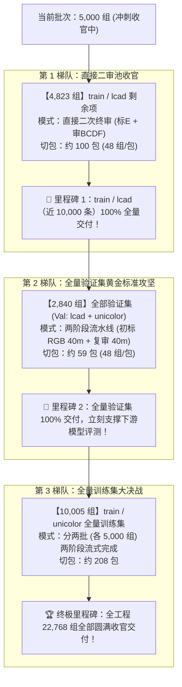

# 训练集／验证集全量交付推进规划（2026-10-16）

> **核心契约**：`train_val_two_stage_NR_legacy_only_v2`  
> **执行口径**：先交付 Train/Val 两模型（全量 22,768 组），Test 暂缓；人工 A 名单直接复用；单图可见自然句，严禁 GT 比较词与等级标题；8 图/包看板流式派发。

---

## 一、 数据集全量摸底与资产分布

经过对 `data/preparation_02/inventory.jsonl` 与 `queue.jsonl` 的地毯式摸底，工程交付总库构成为：

| 划分维度 | 子集 / 模型 | 样本数量 | 占比 | 现状与标注特性 |
| :--- | :--- | :--- | :--- | :--- |
| **Split** | `train`（训练集） | 19,928 组 | 87.5% | 涵盖 lcad 与 unicolor 两个上色模型 |
| | `val`（验证集） | 2,840 组 | 12.5% | 涵盖 lcad（1,420）与 unicolor（1,420） |
| **Model** | `lcad` | 11,384 组 | 50.0% | train 部分（9,923）拥有历史唯一合法底稿 |
| | `unicolor` | 11,384 组 | 50.0% | 全新无底稿样本，需标准两阶段标注 |
| **总计** | **全量正式交付库** | **22,768 组** | **100%** | **两模型全量训练集与验证集** |

---

## 二、 当前进度与剩余待标规模

* **当前已完成/正在冲刺**：
  * 首轮试运行：`100` 组（100% 验收交付，已导出流式包）
  * 批次 5,000 条：`5,000` 组（当前已完成 3,000+ 组，16 路 Worker 持续冲刺中）
  * **累计完成量**：`5,100` 组
* **后续剩余待交付总数**：  
  $$\mathbf{22,768 - 5,100 = 17,668\ 组}$$

---

## 三、 后续剩余 17,668 组三梯队推进路线图

### 1. 第 1 梯队：`train / lcad` 剩余项（4,823 组）
* **特征**：全部具备主人指定的合法旧底稿（`reviewed_1_10000_clean.json`）；
* **标注模式**：与当前 5,000 批次完全一致，直接二次终审（重标 E1/E2，逐 P 审查原 B/C/D/F，自动通过 QualityGate 质检门禁）；
* **看板形式**：8 张无荧光轮廓看板大图/包（48 组/包），共约 100 个任务包；
* **资源与耗时**：16 路 Worker 并发流式吞吐，约 1.5 ~ 2 小时；
* **预期战果**：整个 `train / lcad`（近 1 万组）实现 100% 封板交付。

### 2. 第 2 梯队：全量验证集攻坚（2,840 组）
* **特征**：涵盖 `val / lcad`（1,420 组）与 `val / unicolor`（1,420 组），对算法评估和超参调优至关重要；
* **标注模式**：标准两阶段流式自动化：
  1. **初标阶段**：4 张 2×RGB 绝对差分板/包，快速标定 B/C/D/F，粗粒度直通（耗时约 40 分钟）；
  2. **复审阶段**：4 张彩度差分板/包，重标 E1/E2，逐项复核初标底稿并执行 QualityGate 门禁（耗时约 40 分钟）；
* **资源与耗时**：合计约 1.5 小时内；
* **预期战果**：全量验证集全部两模型 100% 交付出炉。

### 3. 第 3 梯队：Unicolor 训练集决战（10,005 组）
* **特征**：`train / unicolor`（9,964 组）及少量无底稿项（41 组）；
* **标注模式**：两批次分波推进（每批 5,000 组），标准两阶段流式派发；
* **预期战果**：全量 22,768 组终审预测与数据集标注全部圆满交付！
