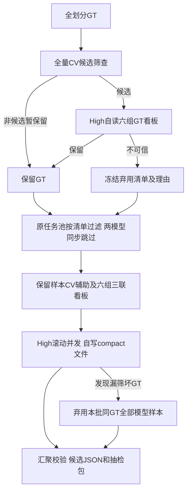

# 活动工作流设计

截至2026-10-13，活动配置CV9（数值沿用CV8，新增短A/E2证据）；实际参数以[config.json](../experiments/cv_workflow/config.json)为准，标签操作以[AGENTS.md](../AGENTS.md)为准。历史阶段默认值查[实验索引](EXPERIMENTS.md)。

## 执行链与数据边界

全部划分GT CV筛查 → 候选GT六组看板确认 → 筛除不可信GT及所有对应模型样本 → 保留任务CV测量/六组看板视觉 → 导入/校验 → 实验候选JSON、抽检流包及来源记录。

指标采用浮点CIELAB，最长边256；局部数值区域定位最长边512。尺寸不同时，程序将生成图对齐GT尺寸后测量/渲染；视觉模型只读任务列出的本地看板，不读取单张原图、任务池、源码或内部manifest。默认fast_single_pass、0补图、主要缺陷短描述，模糊小细节跳过。

S编号在批次内匿名；内部manifest保存原图身份、SHA256、原记录和配置。GT/生成图身份相同但实验条件不同的输出必须保留为独立条件，不能重复合并进同一候选数据集。

GT筛查只在数据新增/重筛时执行；日常批次复用冻结清单。GT阶段看板两列三行、仅GT、匿名G编号；缺陷标注阶段六行三列、GT/生成/热图、匿名S编号，均最多6组/张。

## 标签算法与分工

| 标签 | 当前CV证据 | 视觉阶段职责 |
|---|---|---|
| A缺色 | 相对彩度/结构收缩，交叉拟合ab(L)残差，原色保留比例，彩度缩放竞争解释 | 确认全图颜色结构失败，区别严重局部褪色与自然低彩度 |
| D偏色 | 4×4共同变化、活动像素覆盖、RGB增益/曝光解释、GT颜色分组等权变化及结构保留 | 确认多个物体/背景共同偏移，避免大物体错色主导全图 |
| C错色 | 色相差及可靠方向信号、连通区域候选 | 按GT确认具体物体换色；颜色合理也可能相对GT错配 |
| E1/E2 | 正负彩度差和区域候选 | 按物体判过艳/褪色；不同物体可并存，纯褪色优先E2 |
| B溢色 | 没有新增自动标签分类器 | 看见明确边界越界；模糊小边缘不追查 |
| F视觉自然度 | 没有新增自动标签分类器 | 颜色常识、材质、光照的明确违和，不因C/D自动追加 |

A沿用第4轮结构模型、第8轮联合残差修正：模型曲线残差上限4、结构保留竞争拟合残差上限1。完整约束在global_models.a配置；不能用一个低彩度比直接锁A。

第15轮将既有缩放竞争结果作为短提示证据：scalar_gain>0.03、截距范数≤0.5、拟合残差≤1时，提供“GT对应颜色结构支持、系数、残差”；具体阈值读global_models.a.scale_competition，不另写分类常量。其余为“未确认”，不是A结论。仍有可辨识物体颜色时优先E2，微量噪声/统一泛黄不算保留颜色。证据在review_request匿名S行中，由compact_harness呈现；无需新增CV或图片。该全图支持对局部残余颜色不足，实验生产状态仍false。

D平移分支保留既有条件，并用颜色组共同方向/投影P25和scalar_gain约束；精确增益分支与曝光解释保留。颜色组不是物体，任何CV候选都不是已核验语义标签。

C的可靠方向信号为H×sqrt(min(C_GT,C_gen)/(max(C_GT,C_gen)+ε))，H为原色相分量；削弱近灰色残余方向噪声。区域导航采用P95种子、扩展框及既有JPEG处理，区域不是物体分割。当前cv_navigation=false、默认不画区域框，不能把存储的区域候选当作已提供给模型的语义答案。

## GT参考范围与标签约束

默认信任GT，拿不准仍用GT。仅黑白且无有效物体颜色，或跨不同物体明显异常整体色偏且正常光照不能解释时判不可信；自然低饱和、阴天/夜景/夕阳、舞台灯光、雪景、水下环境、白灰/单色物体主导不单独触发。不设排除配额。训练10,000张GT mean C第1百分位3.5214仍仅是候选：100张低彩度候选中，p95 C<1的仅3张，也不直接判不可信。详见[规则与统计](experiments/gt_reliability_alignment_20261013.md)。

- 常规行检查A/B/C/D/E1/E2/F。
- 主人最新规则：不可信GT直接弃用，不做B/F回退或无参考评价。gt_quality_gate.py扫描train/val/test，按训练分布筛候选，再由Gemini只读匿名GT看板确认两类原因；同GT所有模型样本一起剔除，原数据保留。非候选暂保留，不宣称CV证明其完美。
- config的gt_reference.exclude_manifest引用冻结筛除清单，prepare在生成图CV前跳过对应样本，任务原序号不重排。失败待定候选暂不入标注；过滤任务池另存实验目录。
- 视觉标注发现漏筛坏GT时compact填exclude_GT（异常色偏加GT_evidence短句）；checked_categories为空、decision=excluded_GT，不伪装成defects=[]通过。导出移除同GT全部记录及抽检项，meta.total_images按保留数计，独立保存理由，正式14字段不变。旧BF_only/NR仅兼容历史读取。
- A为唯一缺陷、severity为空字符串、评分规则1.0。
- 主要褪色成浅灰白而无明显换色相优先E2；同一物体不因纯褪色重复添加C。
- 非A用临时视觉L1/L2/L3；严重度不是GT统计分位数推出的结果。
- CV不自动放行样本，旧GPT评分不作为放行资格或标签真值。

## 看板与显示

默认六行三列、6组/张，第三列signed_chroma：ΔC*=C*_生成−C*_GT，正红负蓝。共享deadzone/maximum/gamma；黑色可能存在等彩度错色，红蓝不自动等于E1/E2。

仅保留为可选实验的显示包括彩度/色相双图、三色合成、ab_distance_turbo和ab_distance_orange。后两者显示总a/b距离，不含L亮度，未达到替换默认的证据要求。布局、区域框和显示决策见第7、9、13轮报告。

## 模型、调度与文件契约

默认gemini-3.8-flash-high。agy_runner.py是单任务执行器，模型自行读取本地PNG，直接写reviews_gemini.json，回复只作保存确认；CLI机器封装不承担标注正文，程序从实际文件读取结果。

run_sheet_workers.py是默认批次运行器：最多16个原生agy独立进程/会话，2看板/任务、最多12例；多个已prepare目录共享总上限。空位即补下一任务，各批自身完成即独立导出，失败批次不取消其他批次。新prepare读当前配置，已准备批次保留冻结配置。

新模型调用只生成compact。不可信GT的B/F/NR以及full字段生成已停用；旧JSON解读保持兼容。旧实验要继续新标注时重新prepare过滤批次，不沿用废弃策略启动调用。

compact中null为未看、[]为保留样本看过无主要缺陷；缺陷仅id/severity/object/description。不可信GT用exclude_GT，程序剔除同GT全部样本；BF_only/NR仅兼容历史。主要判断无法成立才uncertain。程序补行政元数据，不编造颜色/位置，保留模型原文件。

逐任务文件在parts/job_*，批次合并reviews_merged.json，再进行完整覆盖、A约束、范围与JSON契约校验。全部成功的独立批次可汇总；配对试验--no-combined-export分别保留条件。通用运行器当前不提供已有parts的自动断点续跑；第13轮专用retry入口复制冻结输入到新尝试目录，保留失败记录。

300秒是单任务模型超时；耗时报告区分调用时长、并发墙钟、准备阶段和恢复尝试。服务错误不作为视觉结果或显示性能证据。

## 候选、来源与评价

各批exports/包含reviewed_candidate.json、tasks_reviewed_stream.json、provenance.json。原gpt_score、labeling_model、labeling_timestamp继承；completed_by=0明确为外部AI，正式字段维持原契约。Label Studio同类多物体只显示最大等级，逐物体记录仍保留，旧导出器不反向覆盖完整候选。

源记录未打分或缺少旧模型/时间戳时，保留完整visual_reviews.json并写source_metadata_pending.json，状态observations_saved_without_source_scores。主机后处理成功，不重复视觉；旧严格候选延期，不用默认值造原评分或元数据。它与uncertain/CLI失败是不同状态。第16轮测试池验证了该分支。

训练GT分布提供分层及参数搜索依据；已知合成干预按GT拆开发/留出，冻结后以新GT确认。旧标签只用于探索，AI对AI/人工参考/合成控制分别记录，不能互作真值。当前production_ready=false、severity_anchors_ready=false。

当前进度查[STATUS](STATUS.md)，任务查[PLAN](PLAN.md)，脚本职责查[活动工具索引](../experiments/cv_workflow/README.md)。历史驱动与搜索配置已归档，不作为当前入口。
